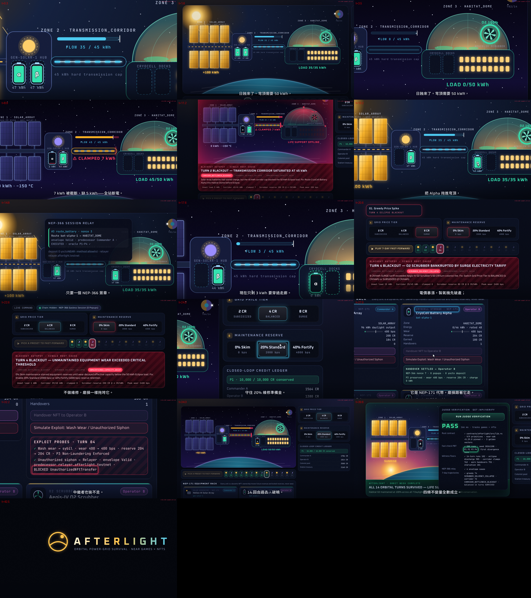
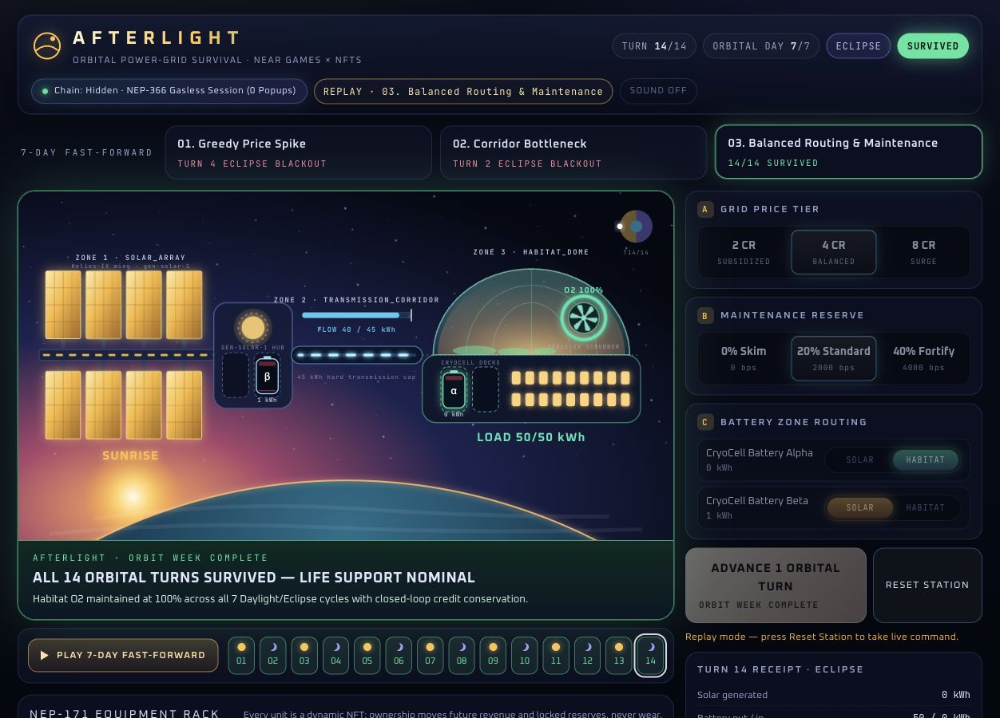
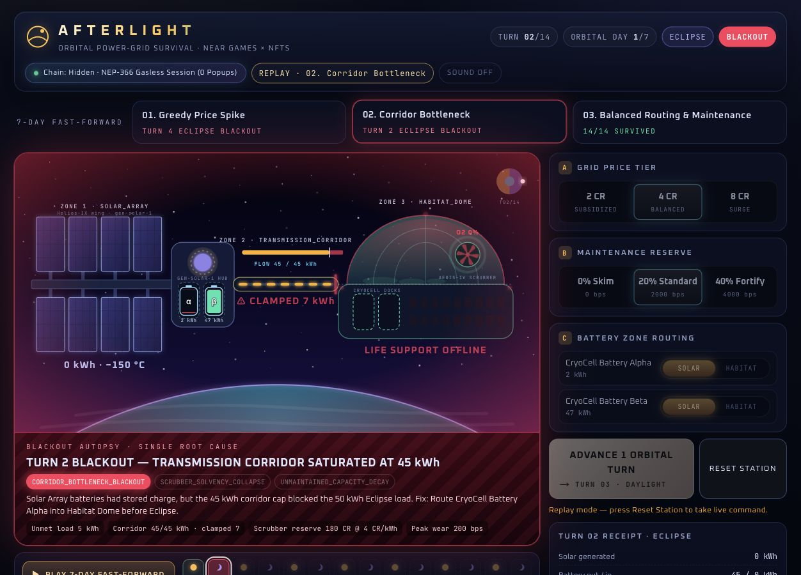
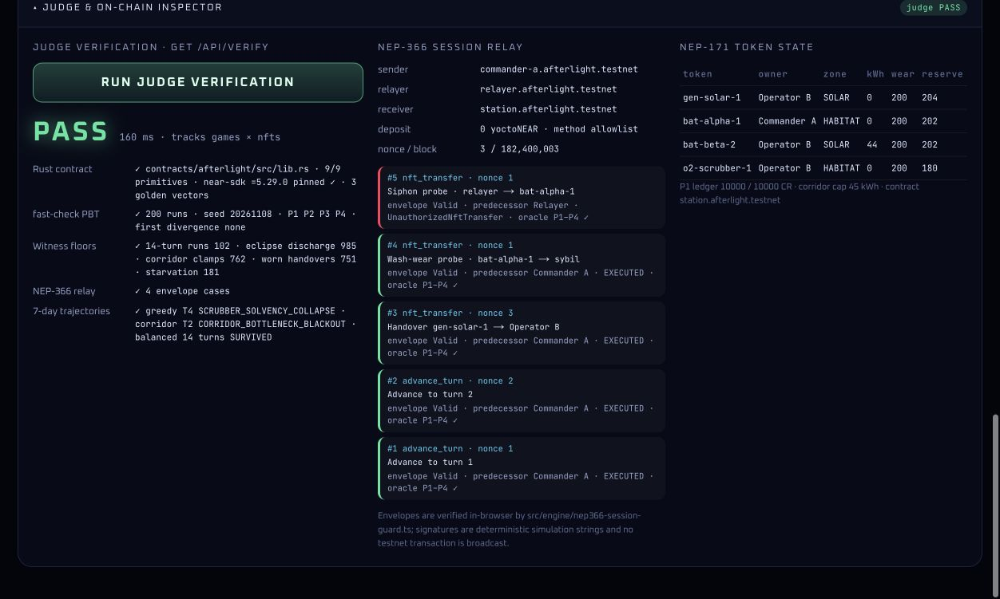

# Afterlight — Orbital Power-Grid & Dynamic Equipment NFT Survival Game on NEAR

[English](/README.md) | [繁體中文](/README.zh-TW.md)

Built for **NEAR Hackathon 2026** (`https://nearhackathon.com/`).

- **Live Interactive Command Deck**: [https://near-afterlight.vercel.app](https://near-afterlight.vercel.app)
- **Public GitHub Repository**: [https://github.com/GGGODLIN/near-afterlight](https://github.com/GGGODLIN/near-afterlight)
- **Tracks**: `games` (Games With Real Economies), `nfts` (NFTs That Do Something)

> **Independent Submission Disclosure (`Q-015`)**: Per NEAR Hackathon Rule `Q-015` (*"Allowed if projects are independent and disclosed: each README names the other project"*), this participant submitted two completely independent entries with zero overlapping tracks and zero shared domain logic:
> 1. **[GhostShift](https://github.com/GGGODLIN/near-ghost-shift)** — Monotonic Epoch Fencing & Yield-Resume Handoff Gate (`tracks`: `security`, `swarms`, `agents`, `business`, `open`, `privacy`).
> 2. **Afterlight** (this repository) — Orbital Station Power-Grid & Dynamic `NEP-171` Equipment NFT Survival Game (`tracks`: `games`, `nfts`).

https://github.com/user-attachments/assets/17458f9b-6380-4bfa-a8e4-e19b7a73ef0a









---

## The Problem: Having Power Does Not Mean It Can Reach the Habitat

Across 14 half-orbit turns (7 orbital Daylight / Eclipse cycles), an orbital colony depends on three interconnected zones:

1. **Solar Array (`SOLAR_ARRAY`)**: Houses `gen-solar-1` (`Helios-IX Solar Array NFT`), which generates `100 kWh` base power during Daylight turns and `0 kWh` during Eclipse turns (`-150°C` orbital shadow).
2. **Transmission Corridor (`TRANSMISSION_CORRIDOR`)**: Enforces a hard physical transmission bottleneck (`corridorCapKwh = 45 kWh/turn`) between the Solar Array and the Habitat Dome.
3. **Habitat & O2 Dome (`HABITAT_DOME`)**: Houses `o2-scrubber-1` (`Aegis-IV O2 Scrubber NFT`) and colonists requiring `35 kWh/turn` in Daylight and `50 kWh/turn` in Eclipse (`35 kWh` habitat + thermal heaters + `15 kWh` O2 scrubber).

Because Eclipse load (`50 kWh`) exceeds the Transmission Corridor capacity cap (`45 kWh`), **even if both `CryoCell` storage batteries (`bat-alpha-1` and `bat-beta-2`) are 100% charged inside `SOLAR_ARRAY`, the corridor saturates at `45 kWh` and the Habitat blacks out (`CORRIDOR_BOTTLENECK_BLACKOUT`)**. Simultaneously, if the commander sets a greedy `SURGE` electricity tariff (`8 CR/kWh`), `o2-scrubber-1` bleeds its operating reserve and goes bankrupt on Turn 4 (`SCRUBBER_SOLVENCY_COLLAPSE`); if maintenance retention is set to `0 bps` (`Skim`), equipment wear degrades effective capacity until life support fails (`UNMAINTAINED_CAPACITY_DECAY`).

---

## How Afterlight Uses Native NEAR Primitives

1. **Dynamic `NEP-171` Equipment NFTs (`contracts/afterlight/src/lib.rs`, `near-sdk = "=5.29.0"`)**:
   - Each equipment unit (`gen-solar-1`, `bat-alpha-1`, `bat-beta-2`, `o2-scrubber-1`) is an `NEP-171` NFT storing live on-chain state: `ownerId`, `zone`, `chargeKwh`, `maxCapacityKwh`, `wearBps`, `reserveCredits`, `cumulativeEarnedCredits`, and `transferCount` (`handover_history` on-chain).
   - Transferring an NFT (`nft_transfer`) transfers future electricity revenue and locked `reserveCredits` to the new operator while strictly preserving `wearBps`, `chargeKwh`, and `zone` (`P3` Non-Laundering Invariance: selling an NFT cannot reset its wear or double-claim reserves).
2. **Closed-Loop Station Credit Ledger (`NEP-141` Compatible Accounting)**:
   - Total station credits (`10,000 CR`) circulate in a closed loop across `operatorA`, `operatorB`, `colonistDemandPool`, `stationTreasury`, and individual NFT `reserveCredits` (`P1` Currency Conservation).
3. **Two-Layer `NEP-366` Gasless Ephemeral Session Guard (`src/engine/nep366-session-guard.ts`)**:
   - Players command the station with **0 wallet popups** via an ephemeral session key signing `NEP-366` `SignedDelegate` meta-transaction envelopes (`attachedDepositYocto === 0`, method allowlist, block-height expiry, monotonic `nonce`, and `effectivePredecessorId === senderId` so a relayer `signerId` can never hijack a player's `NEP-171` NFT).
4. **Cross-Language Integer Basis-Point (`bps: 0..10_000`) Golden Vector Parity**:
   - Both the NEAR Rust smart contract (`contracts/afterlight/src/lib.rs`) and the isomorphic TypeScript engine (`src/engine/afterlight-engine.ts`) execute the exact same 6-step integer `bps` turn pipeline verified against `src/scenarios/golden-turn-vectors.json`.

---

## Reproducible Judge Steps ("Do X, See Y" — Under 60 Seconds)

### Step 1: Run the 60-Second AI Judge Verification Suite (`Q-017`)
- **Do X**:
  ```bash
  npm install
  npm run verify:judge
  ```
- **See Y**:
  - Completes in ~`0.16 seconds` and prints a JSON report with `"verdict": "PASS"` and `"tracks": ["games", "nfts"]`.
  - Verifies all 9 NEAR Rust contract primitives in `contracts/afterlight/src/lib.rs` and all 3 cross-language golden vectors.
  - Runs 200 randomized 14-turn schedules via `fast-check` (`fc.check()`) against the independent algebraic Oracle (`evaluateAfterlightOracleStep`), confirming `P1` (Currency Conservation), `P2` (Energy Balance Conservation), `P3` (`NEP-171` Transfer Non-Laundering & Anti-Sybil Invariance), and `P4` (Corridor Capacity Cap & Terminal Blackout Finality), while passing all 5 Reachability Witness floors (`completed14TurnRunsCount: 102`, `eclipseBatteryDischargeTurnsCount: 985`, `corridorCapClampedTurnsCount: 762`, `degradedNftTransferPreservedCount: 751`, `maintenanceStarvationTurnsCount: 181`).
  - Verifies all 4 `NEP-366` gasless relay cases and dynamically replays the 3 7-day trajectories (`01. Greedy Surge Collapse`, `02. Corridor Bottleneck Blackout`, `03. Balanced 7-Day Survival`).

### Step 2: Run the Full Unit, Property-Based & Rust Contract Test Suite
- **Do X**:
  ```bash
  npm test
  RUSTFLAGS="--cfg clippy" cargo test --manifest-path contracts/afterlight/Cargo.toml
  ```
- **See Y**:
  - Executes all 14 TypeScript tests (`tests/afterlight-engine.test.ts`, `tests/judge-verifier.test.ts`, `tests/api-routes.test.ts`) and the Rust contract golden-vector unit test (`tests::golden_turn_vectors_match_typescript_engine`) with `0` failures.

### Step 3: Play the Interactive Orbital Station Command Deck
- **Do X**:
  Run `npm run dev` and open `http://localhost:3000`.
- **See Y**:
  - Adjust the 3 tactical controls (**Grid Price Tier**, **Maintenance Reserve Retention**, **Battery Zone Routing**), trigger **Fast-Forward 7 Days (14 Turns)** across the 3 trajectory presets, test 1-click **`Handover NFT to Operator B`** vs. **`Simulate Exploit: Wash Wear / Unauthorized Siphon`**, and open the **Judge & On-Chain Inspector** drawer (`Run Judge Verification`).
