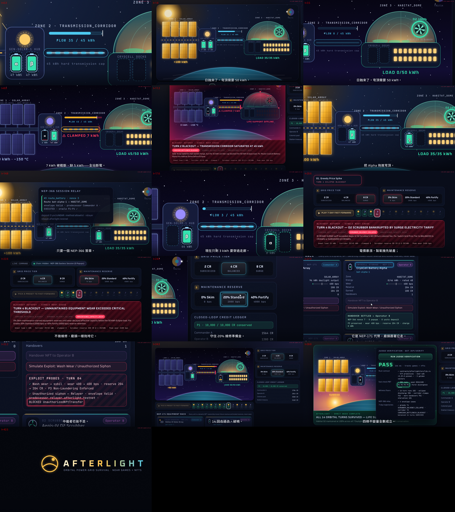
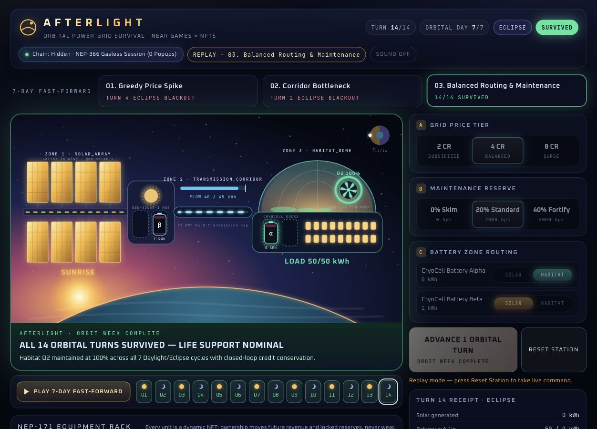
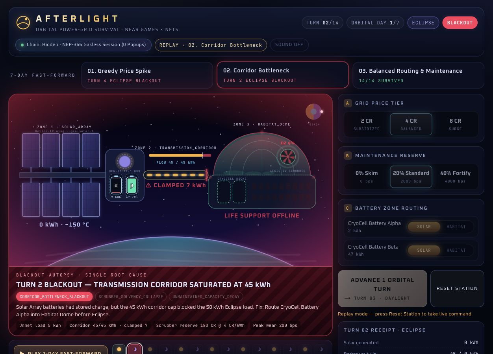
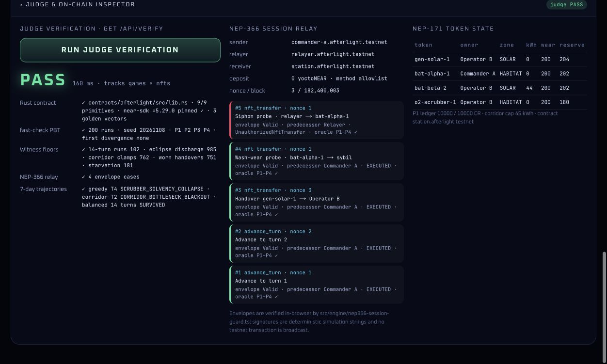

# Afterlight — NEAR 鏈上太空站長夜電網與 NEP-171 動態設備 NFT 生存策略遊戲

[English](/README.md) | [繁體中文](/README.zh-TW.md)

為 **NEAR Hackathon 2026**（`https://nearhackathon.com/`）打造。

- **線上互動戰術指揮艙**：[https://near-afterlight.vercel.app](https://near-afterlight.vercel.app)
- **公開 GitHub 儲存庫**：[https://github.com/GGGODLIN/near-afterlight](https://github.com/GGGODLIN/near-afterlight)
- **X（Twitter）演示貼文**：[https://x.com/GGGODLIN/status/2119268196062798316](https://x.com/GGGODLIN/status/2119268196062798316)
- **參賽賽道（Tracks）**：`games`（Games With Real Economies）、`nfts`（NFTs That Do Something）

> **雙案獨立揭露聲明（規則 `Q-015`）**：依 NEAR Hackathon 官方規則 `Q-015`（*"Allowed if projects are independent and disclosed: each README names the other project"*），本參賽者提交之兩個專案在賽道、問題空間與程式碼上 100% 獨立且零重疊：
> 1. **[GhostShift](https://github.com/GGGODLIN/near-ghost-shift)** — 單調代次柵欄（Monotonic Epoch Fencing）與 `Yield & Resume` 任務交接審計台（賽道：`security`, `swarms`, `agents`, `business`, `open`, `privacy`）。
> 2. **Afterlight**（本儲存庫）— 太空站長夜電網調度與 `NEP-171` 動態磨損設備 NFT 策略生存遊戲（賽道：`games`, `nfts`）。

https://github.com/user-attachments/assets/17458f9b-6380-4bfa-a8e4-e19b7a73ef0a









---

## 解決什麼問題：「發電區明明有電，為什麼居住艙還在日蝕長夜停電？」

在 14 個半軌道回合（7 個軌道日的白晝 `DAYLIGHT` 與日蝕 `ECLIPSE` 交替）中，太空站由三個區域構成：

1. **日照發電翼（`SOLAR_ARRAY`）**：部署 `gen-solar-1`（`Helios-IX` 太陽能帆板 NFT），白晝滿載發電 `100 kWh`，日蝕期間發電 `0 kWh`。
2. **高壓輸電走廊（`TRANSMISSION_CORRIDOR`）**：每回合最大輸電上限為 `corridorCapKwh = 45 kWh`。
3. **居住與製氧穹頂（`HABITAT_DOME`）**：部署 `o2-scrubber-1`（`Aegis-IV` 製氧機 NFT），白晝需電 `35 kWh`（居住 `20 kWh` + 製氧 `15 kWh`），日蝕長夜因保溫加熱器啟動需電 **`50 kWh`**。

因為日蝕長夜的總需求（`50 kWh`）大於輸電走廊上限（`45 kWh`），**就算兩顆 `CryoCell` 儲能電池 NFT（`bat-alpha-1` 與 `bat-beta-2`）在發電翼充滿電，一旦忘記在日蝕前把電池移防到居住穹頂就地放電，電力就會卡死在 `45 kWh` 走廊上限而引發斷電（`CORRIDOR_BOTTLENECK_BLACKOUT`）**；同理，若貪婪拉高暴利電價（`8 CR/kWh`）會害製氧機在第 4 回合破產斷氧（`SCRUBBER_SOLVENCY_COLLAPSE`），若提撥 `0 bps` 維修金則會因設備磨損衰減有效容量而崩潰（`UNMAINTAINED_CAPACITY_DECAY`）。

---

## Afterlight 如何使用 4 項原生 NEAR 原語

1. **`NEP-171` 動態磨損設備 NFT（`contracts/afterlight/src/lib.rs`, `near-sdk = "=5.29.0"`）**：
   - 四張設備 NFT 已在 NEAR Testnet 部署、鑄造。`nft_metadata` 回傳 NEP-177 合約資料；`nft_token` 與可分頁的 `nft_tokens_for_owner` 回傳標準 `token_id`、`owner_id`、`metadata`，動態裝備屬性放在 `equipment` 與 `metadata.extra`。指揮艙分開顯示 RPC 最終確認狀態與訪客本地回合，所有權交接紀錄使用 `handoverHistory`。
   - 轉手設備（`nft_transfer`）會把未來電費分潤與鎖定在設備內的 `reserveCredits` 交接給新營運商，並嚴格保留 `wearBps`、`chargeKwh` 與 `zone`（`P3` 轉手不洗白與反女巫拆分不變性）。
2. **閉環太空站點數帳本（參考 `NEP-141` 帳務概念，並非可轉帳 FT）**:
   - 全站 `10,000 CR` 點數在 `operatorA`、`operatorB`、`colonistDemandPool`、`stationTreasury` 與各設備 `reserveCredits` 之間嚴格閉環守恆（`P1` 貨幣守恆）。
3. **`NEP-366` 雙層免錢包彈窗委託簽章守衛（`src/engine/nep366-session-guard.ts`）**：
   - 訪客指令使用隨機產生的本地 Ed25519 session 金鑰，驗證器用可信本地公鑰驗證完整動作、發送者、接收者、押金、nonce 與期限。這是本地模擬信封，不是 NEP-366 傳輸格式，也不授權真實 NEAR 帳號。部署腳本另外簽署原生 NEP-366 `SignedDelegate`，交給獨立中繼帳號廣播；NEAR 驗證帳號存取金鑰後，合約才分派動作。
4. **跨語言整數基點（`bps: 0..10_000`）黃金向量同構驗證**：
   - NEAR Rust 智慧合約（`contracts/afterlight/src/lib.rs`）與 TypeScript 引擎（`src/engine/afterlight-engine.ts`）執行完全相同的 6 步整數基點回合管線，並由 `src/scenarios/golden-turn-vectors.json` 對照驗證。

---

## 評審 60 秒可重現驗證步驟（"Do X, See Y"）

### 步驟 1：執行 60 秒 AI 評審一鍵驗收套件（`Q-017`）
- **Do X**：
  ```bash
  npm install
  npm run verify:judge
  ```
- **See Y**：
  - 本地測試與 Testnet RPC 驗證都通過才印出 `"verdict": "PASS"`、`"tracks": ["games", "nfts"]`；網路失敗會回 FAIL 與原因。優先使用 [NEAR Testnet RPC](https://rpc.testnet.near.org)，傳輸失敗才改用 [FastNEAR Testnet RPC](https://test.rpc.fastnear.com)，報告會列實際入口。
  - 本地檢查 Rust 原碼結構與 3 組跨語言黃金向量，並不代表執行了 Rust 測試。真鏈檢查會在同一個最終確認區塊讀 `nft_metadata` 與四張 NFT，核對部署、mint、狀態更新及原生中繼交易結果。
  - 透過 `fast-check` 執行 200 次隨機 14 回合序列，驗證貨幣守恆、能量平衡、NFT 轉手不洗白、走廊上限與斷電終態，並檢查可達性見證門檻。
  - 驗證 6 項簽章案例，包含拒絕竄改動作、簽章與替換公鑰，另重播 3 組生存軌跡。

### 步驟 2：執行完整單元測試與 Rust 合約黃金向量測試
- **Do X**：
  ```bash
  node --experimental-strip-types --test --test-concurrency=3 tests/*.test.ts
  PATH="$HOME/.cargo/bin:$PATH" CARGO_BUILD_JOBS=3 cargo test --manifest-path contracts/afterlight/Cargo.toml
  ```
- **See Y**：
  - 2026-11-11 依上述命令通過 17 項 Node 與 8 項 Rust 測試，包含 metadata、mint、動作分派、重播拒絕與轉手屬性保留。API 測試會讀真實 Testnet RPC；另有模擬 RPC 測試確認錯誤處理。

### 步驟 3：啟動互動式太空站橫切面戰術指揮艙
- **Do X**：
  執行 `npm run dev` 並開啟 `http://localhost:3000`。
- **See Y**：
  - 調整 3 項戰術控制（**Grid Price Tier**、**Maintenance Reserve**、**Battery Zone Routing**），點擊 **7-Day Fast-Forward** 播放 3 組 14 回合劇本，實測一鍵 **`Handover NFT to Operator B`** 與 **`Simulate Exploit: Wash Wear / Unauthorized Siphon`**，並展開底部 **Judge & On-Chain Inspector** 抽屜執行 **`Run Judge Verification`**。


## Testnet 部署與交易證據

訪客回合維持本地模擬。點 Run Judge Verification 才會讀取最終確認的 Testnet NFT 狀態與收據。以下示範於 2026-11-11 真實部署、鑄造並更新。

[Afterlight Testnet contract](https://testnet.nearblocks.io/address/afterlight-v1-mwby3nj0.testnet)

| 交易 | 瀏覽器收據 |
|---|---|
| deploy | [GYVTuUtmJnC9pB79tjiKGZVFRKMvqMaQcyXntZVybUUx](https://testnet.nearblocks.io/txns/GYVTuUtmJnC9pB79tjiKGZVFRKMvqMaQcyXntZVybUUx) |
| initialize | [5BmgHMTkxrSrD2G2S6dr1imYW7Y8p4T5CNTfZeQqL97U](https://testnet.nearblocks.io/txns/5BmgHMTkxrSrD2G2S6dr1imYW7Y8p4T5CNTfZeQqL97U) |
| mint-gen-solar-1 | [6MjMeAwhKF1o9wRUPkDara7VVpEWL4ZDna7Wm95fosuo](https://testnet.nearblocks.io/txns/6MjMeAwhKF1o9wRUPkDara7VVpEWL4ZDna7Wm95fosuo) |
| mint-bat-alpha-1 | [HuYC9HgeyJUsey4kPDnpPEBHUsPuUGZ71Qj9SEoJH5eP](https://testnet.nearblocks.io/txns/HuYC9HgeyJUsey4kPDnpPEBHUsPuUGZ71Qj9SEoJH5eP) |
| mint-bat-beta-2 | [BStaVR86U7WpdoEvNETnLo83M5fVufuQACQJGyVg9v8a](https://testnet.nearblocks.io/txns/BStaVR86U7WpdoEvNETnLo83M5fVufuQACQJGyVg9v8a) |
| mint-o2-scrubber-1 | [EJHyBwGqWpnz94aQNFE4z9Xuv6KoZV4ENBxhaSyi6y9c](https://testnet.nearblocks.io/txns/EJHyBwGqWpnz94aQNFE4z9Xuv6KoZV4ENBxhaSyi6y9c) |
| delegate-route | [8n5xou9v9tBdGrwSxqfVdWfS5ArLSUNHAZGpYrWuqFX1](https://testnet.nearblocks.io/txns/8n5xou9v9tBdGrwSxqfVdWfS5ArLSUNHAZGpYrWuqFX1) |
| delegate-advance | [BLqkt6q4vx9kTCG4nfVM9zg276Puhux3SPTaxNiS8mLx](https://testnet.nearblocks.io/txns/BLqkt6q4vx9kTCG4nfVM9zg276Puhux3SPTaxNiS8mLx) |
| redeploy | [67NMsc33qXGuLoVUugEvx5qE1JpF7t1tfDcLdrfUuUVR](https://testnet.nearblocks.io/txns/67NMsc33qXGuLoVUugEvx5qE1JpF7t1tfDcLdrfUuUVR) |
| create-relayer | [AaYqaeRMZzkexdDkBGhRzZzR91eXgp6hbcAosfURENwY](https://testnet.nearblocks.io/txns/AaYqaeRMZzkexdDkBGhRzZzR91eXgp6hbcAosfURENwY) |
| native-nep366-route | [GMdyyfece3qMreHPkFWogrL1Urgz7biCy4bVfBE7wGxk](https://testnet.nearblocks.io/txns/GMdyyfece3qMreHPkFWogrL1Urgz7biCy4bVfBE7wGxk) |

公開交易清單位於 [deployment.json](/src/near/deployment.json)。重建獨立示範時，先用下列命令編譯，再執行 [deploy-testnet.mjs](/scripts/deploy-testnet.mjs)，並將 `AFTERLIGHT_RECEIPT_DIR` 指向 repo 外的本地目錄；私鑰只留在該處，權限為 `0600`，腳本只將公開交易資訊寫入清單。可用 `NEAR_RPC_URL` 指定替代 Testnet RPC。

```bash
PATH="$HOME/.cargo/bin:$PATH" CARGO_BUILD_JOBS=3 RUSTFLAGS="-C target-feature=-reference-types,-multivalue -C link-arg=-s" cargo build --release --target wasm32-unknown-unknown --manifest-path contracts/afterlight/Cargo.toml
```

此 Testnet 示範保留升級金鑰，提供 NEP-171 核心、metadata 與擁有者專用 mint，不含授權管理或正式錢包整合。
